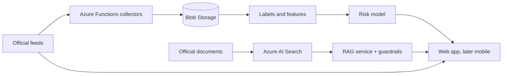

# Bushfire Risk Assistant (Victoria)

An end-to-end machine learning and RAG project: a geospatial model that predicts the next-day probability of bushfire across Victoria on a 2 km grid, and a safety-first assistant that answers preparedness questions with cited official guidance. It runs on Azure and is evaluated on past fire seasons and live, through the 2026–27 season.

> **Not an official warning service.** The risk score is experimental. For warnings and advice use [VicEmergency](https://emergency.vic.gov.au) and the official Fire Danger Ratings. In an emergency, call **000**.

## What it will do

The system has three separate lanes, so generated text can never alter an official warning:

| Lane | Source | Uses an LLM? |
| --- | --- | --- |
| Official status | VicEmergency, CFA and BOM feeds, shown verbatim | No |
| Experimental risk | ML model: fire probability per 2 km cell, 24/48/72 h ahead | No |
| Preparedness guidance | RAG over CFA, EMV, BOM and council documents, every claim cited | Yes, behind guardrails |



## Status (17 November 2026)

- [x] **Live collection on Azure Functions** since 27 Oct 2026: NASA FIRMS, DEA Hotspots (incl. Himawari-9), VicEmergency, CFA fire bans and BOM fire danger ratings, with an hourly staleness check and email alerts
- [x] **Historical fire record:** 579,756 satellite detections inside Victoria, Nov 2000 to now (MODIS and VIIRS)
- [x] **Labels:** detections matched to 7,375 recorded fires (DataVic fire history); 2 km grid of 58,135 cells; 203,134 labelled cell-days
- [x] **Modelling sample:** 1.55 million cell-days (all fires plus 0.5% of no-fire days, weighted), seasons 2012–13 to 2025–26
- [x] **Fire-history features:** recent detections in and around each cell, distance to fire, climatology, years since last burn
- [ ] Weather features (ERA5-Land download in progress)
- [ ] Terrain and vegetation features
- [ ] Baselines and first LightGBM model
- [ ] RAG assistant and evaluation harness
- [ ] Web app, then mobile app with notifications

## How the labels work

Each grid cell on each Melbourne day is **fire**, **no fire** or **ignore**. Satellites cannot tell planned burns and farm burn-offs from bushfires, and those happen in mild weather, so they are excluded rather than counted as fire or as no fire.

| Detection | Label A (strict) | Label B (seasonal) |
| --- | --- | --- |
| Inside a mapped bushfire perimeter | Fire | Fire |
| Unmatched, November–February | Ignore | Fire |
| Unmatched, March–October (mostly burn-offs) | Ignore | Ignore |
| Planned burn, static industrial source, low confidence | Ignore | Ignore |

Training with both labels shows how sensitive results are to label noise.

## Evaluation plan

- **Season splits, never random:** train 2012–13 to 2020–21, validate 2021–23, test 2023–25, plus leave-one-season-out (including Black Summer).
- **Baselines to beat:** climatology, persistence, FFDI and the official Fire Behaviour Index.
- **Metrics:** PR-AUC, recall in the riskiest 5% of cells, calibration; new ignitions reported separately from continuing fires.
- **Live test:** the model runs in shadow mode through 2026–27 and is compared daily with BOM's official ratings.
- **RAG:** a 150–200 question golden set in CI; emergency routing must stay at 100%.

## Key findings so far

- Fire is rare: about 1 fire cell-day in 10,000. Black Summer (2019–20) alone has 14,037 fire cell-days, 42% of all positives.
- 35% of fire cell-days are new ignitions (no fire within ~5 km in the previous week); 29% had fire in the same cell the day before.
- Fire history start dates often lag the first satellite detections by weeks; fixing the matching window raised Black Summer's matched share from 70% to 86%.
- A "years since last fire" feature leaked the future (final fire perimeters reveal where a fire will spread). It now uses previous seasons only.

## Repository structure

```
ingestion/          Azure Functions app: collectors, parsers, staleness check
  collectors/       one module per source + shared HTTP and storage helpers
  parsers/          raw files -> clean tables
ml/data/            historical data, grid, labels, sample, ERA5-Land weather
ml/features/        feature builders
data/               local data, never committed
```

## Running it

```bash
# Collectors (local test)
cd ingestion && python3.11 -m venv .venv && source .venv/bin/activate
pip install -r requirements.txt && cp ../.env.example .env   # add your FIRMS key
python run_local.py                 # download once from every source
python parse_local.py               # raw files -> data/parsed/*.csv
func azure functionapp publish <app-name>   # deploy

# Historical pipeline (repo root, after downloading the sources below)
pip install -r ml/requirements.txt
python ml/data/build_firms_history.py
python ml/data/clip_to_victoria.py
python ml/data/match_fire_history.py
python ml/data/build_grid_labels.py
python ml/data/build_training_sample.py
python ml/features/build_fire_features.py
python ml/data/download_era5land.py 2011-07 2026-10
python ml/data/era5land_daily.py
```

## Roadmap

| Phase | Work |
| --- | --- |
| Features | Weather (incl. drought factor and FFDI), terrain, vegetation, upwind fire |
| Model | Baselines, LightGBM, ConvLSTM prototype on the Next Day Wildfire Spread benchmark, calibration |
| RAG | Corpus, structure-aware chunking, hybrid search, guardrails, golden-set CI |
| App | Web map and chat on Azure Container Apps |
| Mobile | React Native app with watch zones and official-warning push notifications |
| Ops | Infrastructure as code, Key Vault, model registry, drift monitoring |

## Data sources and licences

| Source | Use | Licence |
| --- | --- | --- |
| NASA FIRMS | Fire detections, live and archive | NASA open data; acknowledgement requested |
| DEA Hotspots (Geoscience Australia) | Live hotspots incl. Himawari-9 | CC BY 4.0; © Landgate for Landgate products |
| VicEmergency (EMV) | Incidents and planned burns | CC BY 4.0 |
| CFA RSS feeds | Total Fire Bans | Personal, non-commercial use; links back to CFA |
| BOM IDV18555 | Fire danger ratings and FBI | Personal use only; not redistributed |
| DataVic fire history | Fire perimeters | Creative Commons (see download) |
| ABS ASGS 2021 | State boundary | CC BY 4.0 |
| ERA5-Land (Copernicus) | Weather | Copernicus licence; "Generated using Copernicus Climate Change Service information" |

Raw data is never committed. This repository's code is MIT licensed; the data keeps its own licences.

We acknowledge the use of data and imagery from NASA's Fire Information for Resource Management System (FIRMS), part of NASA's Earth Science Data and Information System (ESDIS).
